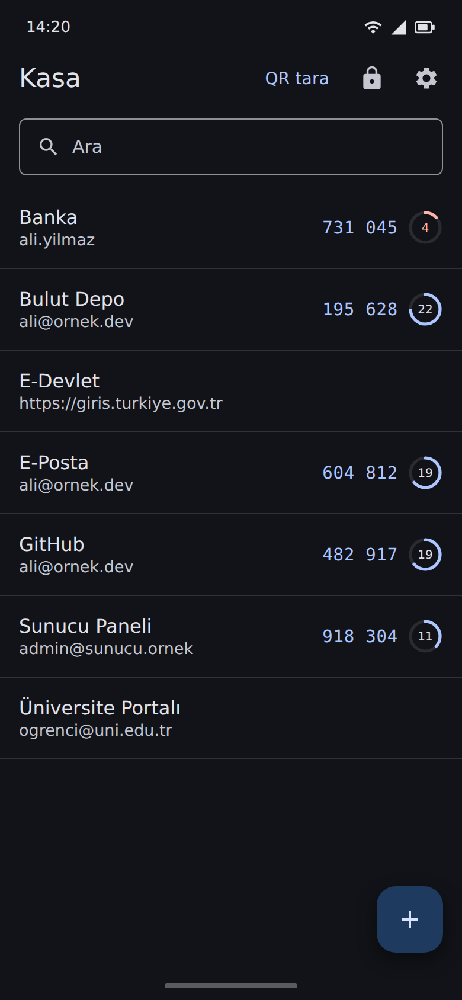
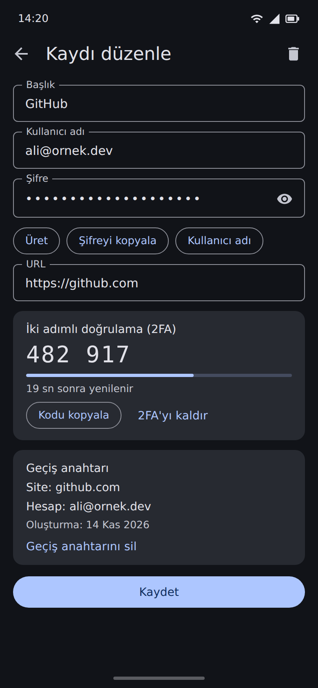
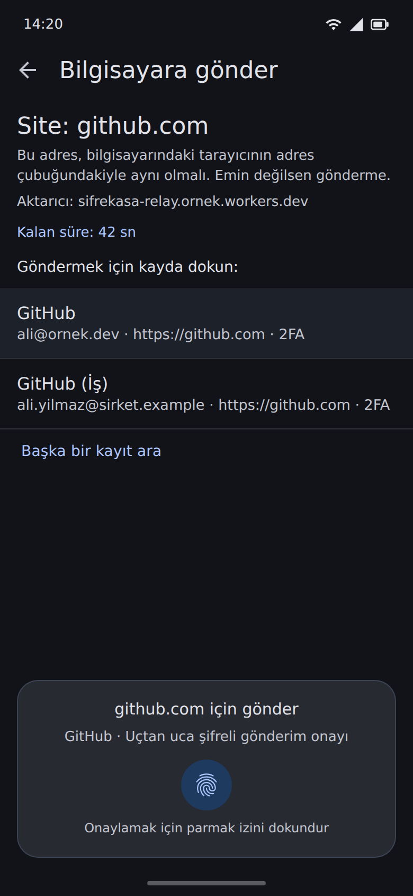
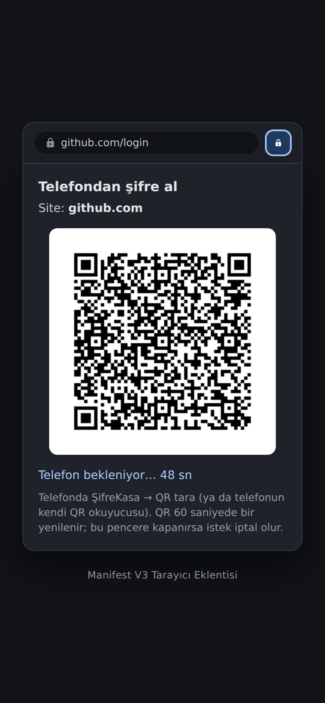
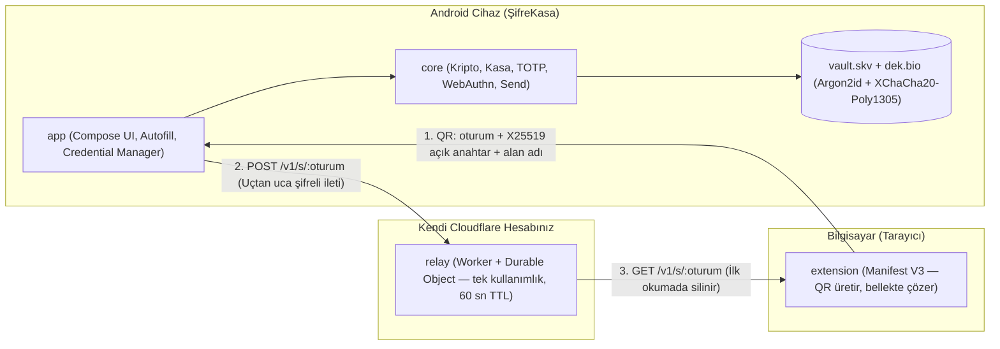

# ŞifreKasa

**Android için yerel-öncelikli, uçtan uca şifreli şifre, 2FA (TOTP) ve geçiş anahtarı (Passkey) yöneticisi.**

[-3DDC84?logo=android&logoColor=white)](#gereksinimler)
[](#proje-yapısı)
[](#kriptografi-ve-güvenlik)
[](#2-tarayıcı-eklentisi-ve-aktarıcı)
[](#2-tarayıcı-eklentisi-ve-aktarıcı)
[](LICENSE)

ŞifreKasa; parolalarınızı, iki aşamalı doğrulama kodlarınızı ve geçiş anahtarlarınızı bulut bağımlılığı olmadan cihazınızda güvenle saklamak için tasarlanmıştır. Analitik, telemetri veya reklam bileşeni içermez; bilgisayarda oturum açarken de hiçbir şifreyi bilgisayarda saklamadan QR kod üzerinden uçtan uca şifreli aktarım yapar.

---

## Öne Çıkan Özellikler

- **Şifreli Yerel Kasa (`SKV1`):** `libsodium` tabanlı **Argon2id** (128 MiB bellek, 3 geçiş) ve **XChaCha20-Poly1305** AEAD ile korunur. Rastgele veri anahtarı (DEK) mimarisi, atomik dosya yazımı ve donanım destekli Android Keystore ile biyometrik kilit açma sunar. Cihaza yeni biyometri eklendiğinde biyometrik anahtar otomatik olarak geçersizleşir.
- **2FA / TOTP (RFC 6238):** `SHA-1`, `SHA-256` ve `SHA-512` algoritmaları ile 6–8 haneli kodları destekler. `otpauth://` QR kodlarını kamerayla tarayarak veya elle girerek ekleyebilir, kasa listesinde canlı geri sayımla görebilirsiniz.
- **Geçiş Anahtarları (Passkeys / WebAuthn + PRF):** Android Credential Manager sağlayıcısı olarak çalışır. P-256 anahtar üretimi, imza, **WebAuthn PRF uzantısı** (ör. şifreli yedek anahtarı türetme) ve masaüstü tarayıcılarla hybrid QR oturum açma akışlarını destekler. Geçiş anahtarları şifreli kasada ve yedeklerde taşınır.
- **Güvenli Otomatik Doldurma (Autofill):** Servis arka planda kasaya erişmez; değerler yalnızca kullanıcı kilidi açıp kaydı seçtikten sonra iletilir. Alan adı ve alt alan adı eşleşmesi, yalnızca Google'ın açık listesindeki imza doğrulamalı tarayıcılara güvenme ve `iframe` koruması içerir. Kayıtta 2FA varsa güncel kod doldurma anında panoya kopyalanır.
- **QR ile Bilgisayara Şifre Gönderme:** Masaüstünde şifre saklamadan, Manifest V3 tarayıcı eklentisi ve kendi Cloudflare Worker aktarıcınız üzerinden **X25519 + HKDF-SHA256 + AES-256-GCM** ile uçtan uca şifreli, tek kullanımlık ve 60 saniye ömürlü aktarım sağlar.
- **Şifreli Dışa/İçe Aktarım ve Otomatik Yedekleme (`.skx`):** Ana paroladan ayrı bir yedek parolasıyla şifrelenir. Android SAF (Storage Access Framework) üzerinden yerel depolamaya veya Google Drive gibi sağlayıcılara otomatik yedeklenebilir — uygulama yedek için internete bağlanmaz. Yazılan her yedek bayt bayt geri okunarak doğrulanır; içe aktarımda kayıtlar kimliğe (`id`) ve `updatedAt` zamanına göre hiçbir kayıt silinmeden birleştirilir.
- **Parola Üretici ve Gizlilik Önlemleri:**
  - 8–128 karakter aralığında, karışan karakterleri (`0O1lI|`) dışarıda bırakabilen kriptografik (`SecureRandom`) parola üretici.
  - `FLAG_SECURE` ile ekran görüntüsü, ekran kaydı ve son uygulamalar önizlemesi koruması.
  - Hassas işaretli ve ayarlanabilir sürede (15 / 30 / 60 sn) otomatik temizlenen pano.
  - Arka plana geçişte ve hareketsizlikte (1 / 5 / 15 dk) otomatik kilit.
  - `allowBackup=false` ve veri çıkarma kurallarıyla sistem yedeklerine sızmaya karşı koruma.

---

## Ekran Görüntüleri

| Kasa ve Canlı 2FA | Kayıt, 2FA ve Geçiş Anahtarı | Bilgisayara Gönder | Tarayıcı Eklentisi |
| :---: | :---: | :---: | :---: |
|  |  |  |  |

*Yukarıdaki görseller, uygulamanın mevcut arayüzünü gösteren örnek önizlemelerdir (uygulama güvenlik amacıyla `FLAG_SECURE` kullandığından gerçek cihazda ekran görüntüsü alınamaz).*

---

## Mimari

ŞifreKasa üç ana bileşenden oluşur: Android uygulaması (`app` + `core`), isteğe bağlı masaüstü tarayıcı eklentisi (`extension`) ve tek kullanımlık şifreli aktarıcı (`relay`).



### Proje Yapısı

| Dizin | Açıklama |
| --- | --- |
| [`core/`](core) | Android'den bağımsız saf Kotlin çekirdek modülü: `SKV1` / `SKX1` dosya biçimleri, `libsodium` sarmalayıcısı, TOTP, WebAuthn/CBOR/PRF, parola üretici, alan adı eşleştirme ve bilgisayara gönderme protokolü. |
| [`app/`](app) | Jetpack Compose (Material 3) arayüzü, Android Keystore biyometrik sarma, CameraX QR tarayıcı, Autofill servisi, Credential Manager geçiş anahtarı sağlayıcısı ve SAF yedek yöneticisi. |
| [`extension/`](extension) | Chrome, Edge, Brave ve Firefox için sıfır depolamalı Manifest V3 tarayıcı eklentisi. Yalnızca `activeTab`, `scripting` ve `storage` izinlerini kullanır. |
| [`relay/`](relay) | Cloudflare Workers + SQLite Durable Objects tabanlı, log tutmayan tek kullanımlık aktarıcı. |
| [`docs/`](docs) | Dosya biçimi, tehdit modeli ve bilgisayara gönderme protokolünün teknik spesifikasyonları. |
| [`tools/`](tools) | `FLAG_SECURE` aktifken emülatörde erişilebilirlik ağacı üzerinden arayüz testi için küçük `adb` yardımcısı (`emu-ui.py`). |

---

## Kriptografi ve Güvenlik

ŞifreKasa kendi kriptografik algoritmalarını geliştirmez; yalnızca standart ve yaygın olarak denetlenmiş kütüphaneleri (`libsodium`, Google Tink, platform Keystore ve WebCrypto) kullanır. Birim testleri, `libsodium` çıktılarını bağımsız kütüphanelerle (**Bouncy Castle**, **Tink**, **WebAuthn4J**) ve RFC test vektörleriyle çapraz doğrular.

| Bileşen | Algoritma ve Tasarım |
| --- | --- |
| **Kasa dosyası (`vault.skv` / `SKV1`)** | Argon2id v1.3 (128 MiB, 3 geçiş, 16 bayt tuz) → KEK; rastgele 32 bayt DEK sarımı ve gövde için XChaCha20-Poly1305 (24 bayt nonce, tüm başlık AD olarak doğrulanır). |
| **Biyometrik kilit (`dek.bio`)** | Donanım destekli Android Keystore anahtarı ile AES-256-GCM; her kullanımda güçlü biyometri ister, yeni biyometri kaydında geçersizleşir. Yedeklere dahil edilmez. |
| **Dışa aktarım / Yedek (`.skx` / `SKX1`)** | Ayrı yedek parolasından Argon2id v1.3 + XChaCha20-Poly1305. Otomatik yedeklemede her yazımda yeni 192 bit rastgele nonce üretilir. |
| **Geçiş anahtarları (Passkeys)** | ECDSA P-256 (PKCS#8 DER, kasada DEK ile şifreli). PRF uzantısı: `HMAC-SHA-256(prfKey, SHA-256("WebAuthn PRF" \|\| 0x00 \|\| girdi))`. |
| **Bilgisayara gönderme (`v1`)** | İki tarafta tek kullanımlık X25519 + HKDF-SHA256 (oturum kimliği ve açık anahtarlara bağlı) + AES-256-GCM (alan adına bağlı AD). |

> [!IMPORTANT]
> Ana parola veya yedek parolası unutulursa kurtarma yolu yoktur. Ayrıca `INTERNET` izni yalnızca kullanıcının onayladığı "bilgisayara gönder" akışı için kullanılır; kasa ve yedekleme tamamen çevrimdışı çalışır.

Ayrıntılı güvenlik ve protokol belgeleri:
- [Dosya Biçimleri (`docs/dosya-bicimi.md`)](docs/dosya-bicimi.md)
- [Tehdit Modeli (`docs/tehdit-modeli.md`)](docs/tehdit-modeli.md)
- [Bilgisayara Gönderme Protokolü (`docs/gonderme-protokolu.md`)](docs/gonderme-protokolu.md)

---

## Gereksinimler

- **Android uygulaması:** Android 14 ve üstü (`minSdk = 34`, `targetSdk = 36`), derleme için JDK 17 ve Android SDK.
- **Tarayıcı eklentisi (isteğe bağlı):** Chrome / Edge / Brave **133+** veya Firefox **130+**.
- **Aktarıcı (isteğe bağlı):** Node.js ve ücretsiz bir Cloudflare hesabı.

---

## Kurulum ve Derleme

### 1. Android Uygulaması

Depoyu klonlayın:

```bash
git clone https://github.com/b11s3c/SifreKasa.git
cd SifreKasa
```

#### Hata ayıklama (Debug) derlemesi

```bash
./gradlew :app:assembleDebug
```

#### Günlük kullanım için imzalı sürüm (Release) derlemesi

Sürüm derlemesi R8 ile küçültülür, hata ayıklanamaz (`debuggable=false`) ve `arm64-v8a`, `armeabi-v7a`, `x86_64`, `x86` mimarilerini içerir.

1. [`keystore.properties.example`](keystore.properties.example) dosyasını proje kökünde `keystore.properties` adıyla kopyalayın ve kendi anahtar deponuzun bilgilerini doldurun (`keystore.properties` `.gitignore` içindedir):
   ```properties
   storeFile=sifrekasa-release.jks
   storePassword=ANAHTAR_DEPOSU_PAROLASI
   keyAlias=sifrekasa
   keyPassword=ANAHTAR_DEPOSU_PAROLASI
   ```
2. Sürüm APK'sını derleyin:
   ```bash
   ./gradlew :app:assembleRelease
   ```
   *(Not: `keystore.properties` bulunmazsa Gradle imzasız bir sürüm APK'sı üretir.)*

> [!TIP]
> Uygulamayı kurduktan sonra **Ayarlar → Otomatik doldurma ve geçiş anahtarları** bölümünden ŞifreKasa'yı sistem sağlayıcısı olarak etkinleştirebilirsiniz. Chrome'da otomatik doldurma için ayrıca Chrome ayarlarında *"başka bir hizmetle doldur"* seçeneğinin açık olması gerekir.

### 2. Tarayıcı Eklentisi ve Aktarıcı

Bilgisayara QR ile şifre göndermeyi kullanmak için kendi aktarıcınızı kurup eklentiye tanımlamanız yeterlidir:

1. **Aktarıcıyı dağıtın** (ücretsiz Cloudflare planı yeterlidir):
   ```bash
   cd relay
   npm install
   npx wrangler login
   npx wrangler deploy
   ```
   Komut sonunda üretilen `https://sifrekasa-relay.<hesabiniz>.workers.dev` adresini not alın. Ayrıntılar için [`relay/README.md`](relay/README.md) dosyasına bakın.

2. **Tarayıcı eklentisini yükleyin:**
   - **Chrome / Edge / Brave (133+):** `chrome://extensions` → *Geliştirici modu* → *Paketlenmemiş öğe yükle* → `extension/` klasörünü seçin.
   - **Firefox (130+):** `about:debugging#/runtime/this-firefox` → *Geçici Eklenti Yükle* → `extension/manifest.json` dosyasını seçin.
   - Eklenti ayarlarına yukarıdaki aktarıcı adresini girin. Telefon, aktarıcı adresini ilk QR taramasında onayınızla sabitler. Ayrıntılar için [`extension/README.md`](extension/README.md) dosyasına bakın.

---

## Testler

### Çekirdek Kripto ve Protokol Testleri (`:core`)

Argon2id, XChaCha20-Poly1305, `SKV1` / `SKX1` biçimleri, TOTP (RFC vektörleri), WebAuthn/CBOR/PRF, parola üretici ve gönderme protokolü testlerini çalıştırır:

```bash
./gradlew :core:test
```

Gerçek bir `.skx` dışa aktarım dosyasının bağımsız kütüphanelerle (Bouncy Castle + Tink) açılabildiğini doğrulamak için:

```bash
./gradlew :core:test --tests '*ExternalFileInteropTest*' \
  -Pskx.file=/yol/dosya.skx \
  -Pskx.password=yedek-parolaniz
```

### Tarayıcı Eklentisi Testleri

```bash
cd extension
npm test
```

### Aktarıcı Testleri

İlk terminalde yerel aktarıcıyı başlatın:

```bash
cd relay
npm run dev
```

İkinci terminalde testleri çalıştırın:

```bash
cd relay
RELAY_URL=http://127.0.0.1:8787 npm test
```

---

## Belgeler

- [docs/dosya-bicimi.md](docs/dosya-bicimi.md) — `SKV1` ve `SKX1` ikili dosya başlıkları, JSON şeması ve uygulama dışında şifre çözme.
- [docs/tehdit-modeli.md](docs/tehdit-modeli.md) — Korunan varlıklar, güven sınırları, tehdit–önlem tablosu ve kapsam dışı durumlar.
- [docs/gonderme-protokolu.md](docs/gonderme-protokolu.md) — QR ile bilgisayara şifre gönderme protokolü (`v1`) ve bilinen sınırlar.
- [extension/README.md](extension/README.md) — Tarayıcı eklentisi kurulum ve kullanım rehberi.
- [relay/README.md](relay/README.md) — Cloudflare Worker aktarıcısı dağıtım ve test rehberi.

---

## Lisans

Bu proje [MIT Lisansı](LICENSE) altında lisanslanmıştır.

Tarayıcı eklentisinde yer alan [`extension/vendor/qrcode.js`](extension/vendor/qrcode.js) dosyası `qrcode-generator` 1.4.4 (Kazuhiko Arase, MIT Lisansı) paketinden değiştirilmeden alınmıştır.
