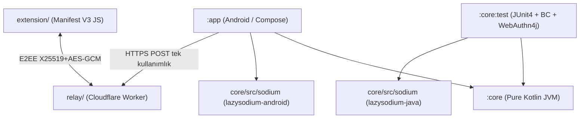

# ŞifreKasa — Mimari Genel Bakış

## 1. Modül Yapısı

| Dizin / Modül | Sorumluluk |
|---|---|
| `core/` | Platformdan bağımsız kripto, dosya biçimleri (`SKV1`, `SKX1`), TOTP (RFC 6238), WebAuthn/CBOR/Passkey/PRF, alan adı eşleştirme (`DomainMatcher`), QR çözümleme, bilgisayara gönderme protokolü (`SendProtocol`), parola üreteci. |
| `app/` | Android uygulaması: Jetpack Compose UI, `VaultRepository`, `BackupManager` (SAF), `BiometricKeyStore`, `LockManager`, `ClipboardHelper`, `SifreKasaAutofillService`, `SifreKasaCredentialService` (Passkey), `RelayClient`. |
| `extension/` | Bilgisayarda şifre saklamadan QR ile tek seferlik form dolduran tarayıcı eklentisi (Chrome/Edge/Brave/Firefox). |
| `relay/` | Şifreli tek iletiyi 60 saniye tutan ve ilk okumada silen Cloudflare Worker + Durable Objects aktarıcısı. |
| `tools/` | `emu-ui.py` — `FLAG_SECURE` aktifken ADB erişilebilirlik ağacıyla emülatör UI sürüş aracı. |
| `docs/` | Güvenlik/protokol belgeleri (`tehdit-modeli.md`, `dosya-bicimi.md`, `gonderme-protokolu.md`), proje hafızası (`project/`), test stratejisi (`testing/`), Google Play hazırlıkları (`play-store/`) ve günlük kayıtlar (`daily/`). |

## 2. `:app` Paket Organizasyonu (`dev.sifrekasa`)

- **Kök:** `SifreKasaApp` (manuel DI `AppContainer`), `MainActivity` (`FLAG_SECURE`, `sifrekasa://send` deep link).
- **`data/`:** `VaultRepository` (kasa durum makinesi: `NoVault` / `Locked` / `Unlocked`, atomik yazma), `AppSettings`, `BackupManager` (SAF otomatik şifreli yedek), `RelayClient`.
- **`security/`:** `BiometricKeyStore` (AES-256-GCM DEK sarma), `BiometricAuth`, `LockManager` (arka plan + hareketsizlik kilidi), `ClipboardHelper` (süreli temizleme), `PrivilegedApps` (`assets/privileged_apps.json` imza doğrulama).
- **`autofill/`:** `SifreKasaAutofillService`, `AutofillPickerActivity`, `StructureParser`.
- **`passkey/`:** `SifreKasaCredentialService`, `PasskeyActivity`, `PasskeyRequests`.
- **`ui/`:** `AppRoot`, `SetupScreen`, `UnlockScreen`, `VaultListScreen`, `EntryEditScreen`, `SettingsScreen`, `BackupSection`, `QrScannerScreen`, `SendScreen`, `GeneratorDialog`, `PasswordDialogs`, `Theme`, `Common`.

## 3. Veri ve Güvenlik Akışı

1. **Kasa Açılışı:** Ana parola → Argon2id (3 geçiş, 128 MiB) → KEK → DEK çözülür (veya Biyometri → Keystore AES-GCM → DEK).
2. **Kayıt Değişikliği:** `VaultRepository.mutate()` → `AtomicFile` ile `vault.skv` yeniden şifrelenir (yeni nonce) → yedekleme etkinse `onBackupReady` tetiklenir ve `.skx` SAF üzerinden güncellenir.
3. **Kilitlenme:** `LockManager` (arka plan veya süre aşımı) → `VaultRepository.lock()` → DEK `Secrets.wipe()` ile sıfırlanır, durum `Locked` olur.
